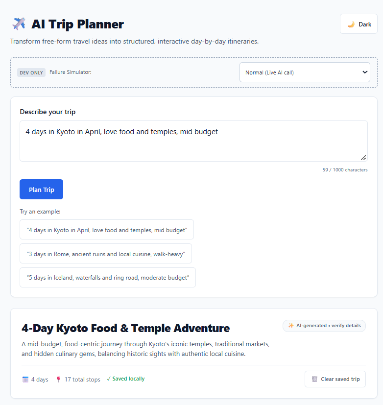
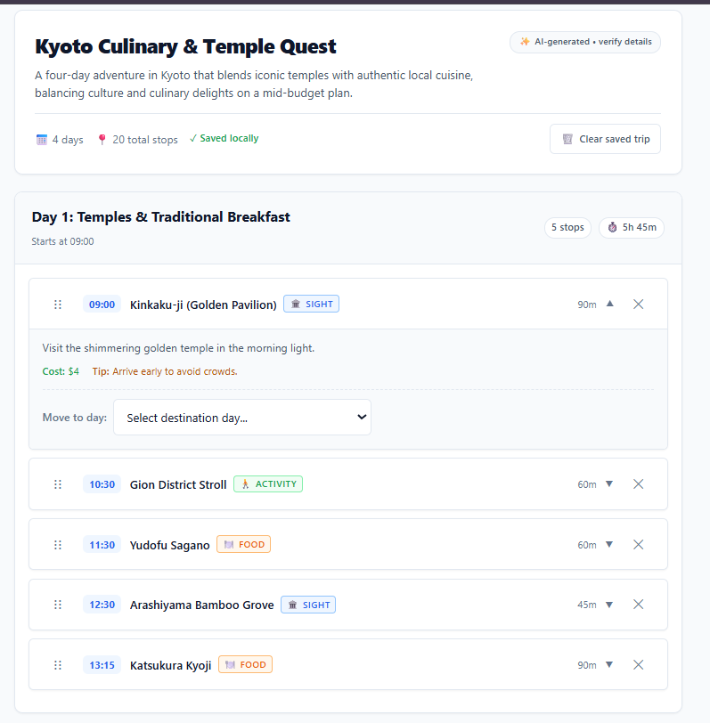

# AI Trip Planner

Describe a trip in plain English (for example *"4 days in Kyoto in April, love food and temples, mid budget"*) and get back an interactive, day-by-day itinerary. This is not a chatbot: the model returns structured JSON, and the app validates it and renders it as stateful UI. Every model response goes through extraction, validation, salvage, and repair steps before anything reaches the screen.

You can expand stop cards (cost estimate and tip), drag stops to reorder them with times recalculated instantly, remove stops with a 6-second undo, move stops between days, refine the plan with follow-up prompts ("make day 2 more relaxed"), and reload the page without losing your trip. It works on mobile (day tabs below 768px) and has a dark mode.




<!-- DEMO VIDEO: after uploading, replace this comment with:
**Demo video:** [Watch the walkthrough](PASTE_LINK_HERE)
-->

---

## Setup

### Prerequisites

- Node.js and npm. Developed and tested on Node 24 (Vite 6 needs a recent Node, 18 or newer).
- A free API key from **Groq** (recommended, fast) or **Google Gemini**.

### Install and run

```bash
git clone https://github.com/syamtirumalla/trip-planner.git
cd trip-planner
npm install
cp .env.example .env        # on Windows Command Prompt: copy .env.example .env
```

Open `.env` and set `GROQ_API_KEY` (or `GEMINI_API_KEY` and `PROVIDER=gemini`). Then:

```bash
npm start
```

This starts both processes:

- Express API server: `http://localhost:3001`
- Vite React client: `http://localhost:5173` (proxies `/api` to the server)

Open `http://localhost:5173`.

**Windows note:** if the client fails to start with "An Application Control policy has blocked this file" for a Rollup `.node` file, your Windows security policy (for example Smart App Control) is blocking the native binary. This is a machine policy, not a project issue. Try again on a machine without that policy.

### Environment variables

| Variable | Default | Description |
| :--- | :--- | :--- |
| `PORT` | `3001` | Express server port |
| `NODE_ENV` | `development` | When set to `production`, the failure simulator and `x-simulate` header are disabled |
| `PROVIDER` | `groq` | AI provider: `groq` or `gemini` |
| `MODEL_TIMEOUT_MS` | `45000` | Timeout for each upstream model call, in milliseconds |
| `MAX_OUTPUT_TOKENS` | `4096` | Output token limit for Gemini calls (Groq uses a higher limit because reasoning tokens count against it) |
| `GROQ_API_KEY` | (empty) | Required when `PROVIDER=groq` |
| `GROQ_MODEL` | `openai/gpt-oss-20b` | Groq model name |
| `GEMINI_API_KEY` | (empty) | Required when `PROVIDER=gemini` |
| `GEMINI_MODEL` | `gemini-3.8-flash` | Gemini model name |

Model names change over time. If you get a "model not found" error, check the provider's current model list and update the variable.

### Getting an API key

- **Groq:** sign in at `console.groq.com`, open **API Keys**, create a key (it starts with `gsk_`).
- **Gemini:** sign in at `aistudio.google.com`, choose **Get API key**, create a key (it starts with `AIza`).

### Switching providers

Both providers sit behind one `callModel(prompt)` function. Change `PROVIDER` in `.env` and restart `npm start`. No other code changes are needed.

### Security note

The API key is only read on the server and is never sent to the browser. `.env` is git-ignored, and only `.env.example` (placeholders) is committed. The failure simulator is disabled when `NODE_ENV=production`.

---

## How it works

```text
[ User prompt / refinement ]
            |
            v
[ React client (Vite, :5173) ]
  - pure reducer: idle | loading | error | success
  - stale-response protection (requestId + AbortController)
            |  POST /api/plan  or  /api/refine
            v
[ Express server (:3001) ]
  1. validate the request
  2. dev only: apply x-simulate failure, if requested
  3. build the prompt (JSON only, exact day count, realistic pacing)
  4. callModel(prompt)            -> Groq or Gemini via plain fetch
  5. extractJson(text)            -> strip fences / surrounding prose
  6. validate + salvage           -> stop-by-stop Zod validation
       on failure: one repair retry with the error fed back to the model
  7. semantic check               -> did we get as many days as asked?
            |  { itinerary, warnings }
            v
[ Client ]
  - re-validate with the same shared Zod schema
  - assign client-side ids, compute stop times
  - auto-save to localStorage
            v
[ Interactive UI ]
```

### Shared schema (`shared/schema.js`)

One Zod 4 schema is used by both the server and the client:

- **Stop:** `name`, `type` (`food`, `sight`, `activity`, `transit`, `rest`), `durationMin` (15 to 480), `description`, optional `costEstimate` and `tip`.
- **Day:** `label`, `startTime` (`HH:MM`, default `09:00`), and a list of stops.
- **Itinerary:** `title`, optional `summary`, and at least one day.

Ids from the model are never trusted. The client assigns its own ids after validation, and stop start times are derived from the day's start time plus the durations of the stops before it.

### Server pipeline

1. **Prompt** (`promptBuilder.js`): demands JSON only, the exact number of days requested, at least three stops per day, a realistic day length, sensible meal order, and no filler stops.
2. **Model client** (`modelClient.js`): plain `fetch` to each provider with a timeout. Groq uses JSON mode, a low reasoning effort, and a higher token limit, and retries once with a larger limit if the response was cut off (`finish_reason: length`). Gemini uses a low thinking level and a short backoff and retry on 503. Raw provider errors are logged on the server only, never returned to the client.
3. **JSON extraction** (`jsonExtractor.js`): strips markdown fences and surrounding prose, takes the outermost JSON object, and rejects anything that isn't an object.
4. **Validation and salvage** (`validator.js`): each stop is validated on its own. Invalid stops are dropped with a warning, days with no valid stops are dropped, and a malformed start time falls back to `09:00`. If nothing valid is left, the request is treated as a failure.
5. **Repair retry:** if the output can't be parsed or salvaged, the model gets one chance to fix its own output, given the validation error.
6. **Semantic check** (`semanticCheck.js`): finds a requested day count in the prompt ("4 days", "a week", "long weekend") and adds a warning if fewer days came back.

### Client

- **State machine** (`plannerReducer.js`): a pure reducer with explicit `idle`, `loading`, `error`, and `success` states.
- **Stale responses:** every request gets an incrementing id and an `AbortController`. Starting a new request aborts the old one, and any response that isn't from the latest request is ignored. A Cancel button is available while loading.
- **Times** (`time.js`): a pure `recomputeTimes` function, used after every removal, reorder, move, or undo.
- **Drag and drop** (`@dnd-kit`): a dedicated drag handle, with pointer, touch (press and hold), and keyboard sensors. The handle keeps dragging separate from the expand and remove buttons. A "Move to day" select moves a stop to another day without dragging.
- **Undo toasts** (`Toast.jsx`): each removal has a 6-second undo that restores the stop to its original position. At most 3 toasts show at once, with a "+N more" counter so removals can still be undone.
- **Mobile tabs** (`DayTabs.jsx`): below 768px days become tabs with proper tab roles and arrow-key navigation. Larger screens show stacked days.
- **Refinement** (`RefineForm.jsx`): follow-up prompts call `/api/refine` with the current itinerary. The model returns the full updated plan, and `reconcile.js` keeps the ids of unchanged stops so the UI stays stable. "Undo refinement" restores the previous plan.
- **Saving** (`storage.js`): the trip is saved to localStorage under a versioned key and re-validated with the shared schema on load. Corrupted or outdated data is discarded. A "Clear saved trip" button is provided.
- **Dark mode:** follows the system setting and can be toggled. A small inline script prevents a flash of the wrong theme on load.

---

## Failure modes I handle

The simulator is available in development through the **Failure Simulator** dropdown on the page, or by sending the `x-simulate` header to `/api/plan`. It is disabled when `NODE_ENV=production`.

| Failure | What the user sees | How it's handled | How to trigger it |
| :--- | :--- | :--- | :--- |
| Malformed JSON | A normal itinerary if the repair retry succeeds; otherwise an error card with Retry | Extract, parse, then one repair retry. If that fails, a typed `MALFORMED` error | `x-simulate: malformed` |
| Wrong shape | A normal itinerary if repair succeeds; otherwise an error card with Retry | Zod validation fails, one repair retry, then a typed `WRONG_SHAPE` error. The client validates again | `x-simulate: wrong-shape` |
| Empty output | An error card with Retry | Typed `EMPTY` error | `x-simulate: empty` |
| Slow or timed-out model | An error card with Retry | Each model call is bounded by `MODEL_TIMEOUT_MS`, giving a typed `TIMEOUT` error. The user can also press Cancel while waiting | `x-simulate: slow` |
| Upstream server error | "The AI service encountered an upstream issue. Please retry in a few moments." with Retry | Upstream 5xx maps to a typed `UPSTREAM` error. Raw provider text stays in the server log | `x-simulate: http500` |
| Rate limited (429) | An error card asking the user to wait and retry | Typed `RATE_LIMITED` error | `x-simulate: rate-limit` |
| Some stops invalid | The itinerary, plus a dismissible warning that some stops were left out | Stop-level salvage drops only the bad stops | `x-simulate: partial` |
| Output cut off (`finish_reason: length`) | A normal itinerary, or an error if it still doesn't fit | One retry with a larger token limit | Hard to trigger on demand (covered by unit tests) |
| Fewer days than requested | A warning such as "You asked for 4 days but only 2 were generated" | `semanticCheck.js` compares the requested and returned day counts | Happens occasionally with real model output |
| Stale response | The newest request wins; older results never appear | Request ids plus `AbortController` | Submit two prompts quickly |
| Corrupted saved trip | The app starts empty instead of crashing | Saved data is re-validated and discarded if invalid | Edit `trip_planner_v1` in DevTools, then reload |
| A component throws | A fallback screen instead of a blank page | `ErrorBoundary` | n/a |

---

## Tests

```bash
npm test
```

Vitest runs 84 tests across 11 files:

- **Server:** JSON extraction (fenced, surrounded by prose, garbage), stop-level salvage, the semantic day-count check, the failure simulator, and the Groq client (response parsing, 429/500/timeout mapping, truncation handling, provider switching).
- **Client:** the reducer (state transitions, stale-response rejection, remove and restore, reorder, move between days, refinement), time calculation, localStorage saving and validation, tab keyboard logic, id reconciliation, and theme handling.

There are no component-level click tests. A prop-wiring bug in the remove button (introduced when drag and drop was added) slipped through because the reducer tests never exercised a real click. See "What I'd do next".

---

## Provider comparison (measured on my machine)

I tried both providers on the same prompts. These are a handful of runs, not a rigorous benchmark.

| | Gemini (`gemini-3.8-flash`) | Groq (`openai/gpt-oss-20b`) |
| :--- | :--- | :--- |
| 3-day trip (Rome) | Timed out at 30s on the first attempt. After lowering the thinking level, one run finished in 31.7s | 2.4s to 3.0s |
| 6-day trip (Japan) | Timed out at 45s | About 4.1s |
| 4-day trip (Kyoto) | Not measured | About 1.8s |
| Errors seen | One HTTP 503 early on | None in my testing |

Other things I ran into:

- `gemini-2.5-flash` was rejected by the API as no longer available to new users on my account.
- On Groq's reasoning model, hidden reasoning tokens count against `max_tokens`. With a 4096 limit this intermittently cut itineraries short (fewer days than requested). Lowering reasoning effort, raising the limit, logging `finish_reason`, and adding the day-count check fixed it.

Because of the first two problems, the provider is swappable. Switching takes one environment variable, and the validation, repair, and UI code doesn't change.

---

## Decisions and trade-offs

1. **Plain `fetch` instead of provider SDKs.** One less dependency, and timeout and abort handling are identical for both providers. It's also easy to explain line by line.
2. **Plain CSS with custom properties instead of a CSS framework.** No build setup to debug, and theming (including dark mode) is just variables.
3. **No streaming.** The app needs complete, valid JSON before it can render cards. Partial JSON can't be validated, so streaming would have made salvage and repair much harder.
4. **Stop-level salvage instead of all-or-nothing validation.** If one of twelve stops is invalid, the other eleven are still useful, so the user gets the trip plus a warning.
5. **Validation even with JSON mode.** JSON mode makes the output parseable, but it doesn't guarantee the right shape or content, so the schema check always runs.

---

## Known limitations

- **Content quality.** The model can suggest closed venues, wrong prices, or invented places. Treat every itinerary as a draft and verify details (the UI says "AI-generated, verify details").
- **Routing and geography.** The model doesn't plan routes. In testing, a day in Kyoto bounced between opposite sides of the city. Dragging stops lets the user fix the order.
- **Meal order and duplicates.** I saw dinner listed before lunch, and the same restaurant used for two meals. The app checks structure and day count, but not meal order or duplicate stops.
- **Fewer days than requested.** This happened occasionally (for example 2 days returned for a 4-day request). The app shows a warning, but the user has to resubmit manually.
- **No component click tests**, as described above.
- **Free-tier limits.** Both providers enforce rate limits, and model availability changes without notice.
- **Local only.** Saving uses the browser's localStorage. There are no accounts, no database, and no deployment.

---

## What I'd do next

1. Add React Testing Library component tests (click remove, undo, expand) and Playwright end-to-end tests for drag, tabs, and toasts.
2. Add semantic checks for meal order, duplicate stops, and total day length, with a one-click "regenerate" on warnings.
3. Group stops by neighbourhood, or verify places and opening hours with a places API.
4. Show stops on a map with routes between them.
5. Export to calendar or PDF, and deploy the app with the API behind a serverless function.

---

## AI usage note

I used AI heavily on this project and tried to stay in control of it.

**Tools**

- **Claude (chat):** planning and scoping, choosing the project and stack, writing the phased build prompt, and reviewing the code agent's output, errors, and test results.
- **Antigravity (Gemini 3.8 Flash, High):** generated most of the code, one phase at a time, with a commit and a summary after each phase.

**How I worked**

- I split the build into 8 phases and approved each one before moving on, so I could read the files it produced.
- After each phase I ran the tests and checked the behaviour in the browser, including the failure simulator and a 375px mobile view.
- The architecture decisions (plain `fetch`, plain CSS, no streaming, stop-level salvage) were scoped and chosen by me.

**Things the AI got wrong that I had to catch and fix**

- The agent first created the project in a temporary scratch folder instead of my workspace.
- `gemini-2.5-flash` was no longer available to my account.
- `gemini-3.8-flash` timed out on 3-day itineraries even with a low thinking level, so I measured alternatives and added Groq as a swappable provider.
- A prop-wiring regression from the drag-and-drop work made the remove button silently do nothing. The reducer tests passed because they never exercised a real click.
- Hidden reasoning tokens counted against `max_tokens` and intermittently truncated itineraries.
- Stacked undo toasts covered the remove buttons, which I fixed in the mobile polish phase.

## Time spent

About **5 hours** in total, over three sessions. This is wall-clock time while I was actively working (planning, reading the agent's output, testing, debugging), estimated from git commit timestamps and excluding breaks. The AI agent's own active working time was about 1h 40m of this.

| Session | Work | Hours |
| :--- | :--- | :--- |
| 1 (Nov 10, evening) | Planning and scoping, project setup and environment problems (wrong working folder, dependency audit, API keys), phases 1 and 2 (scaffold, schema, validation, salvage, repair retry) | ~1h 45m |
| 2 (Nov 11, morning) | Gemini timeouts and model debugging, adding Groq as a second provider, phases 3 to 7 (state machine, itinerary UI, drag and drop, mobile polish, save/restore, dark mode, refinement), and fixing the removal and truncation bugs | ~2h 10m |
| 3 (Nov 11, afternoon) | README, clean-clone test, screenshots, demo recording, final checks | ~1h 15m |
| **Total** | | **~5h 10m** |

I stayed under the 8-hour budget, so I stopped at the "what I'd do next" list below instead of adding more features.